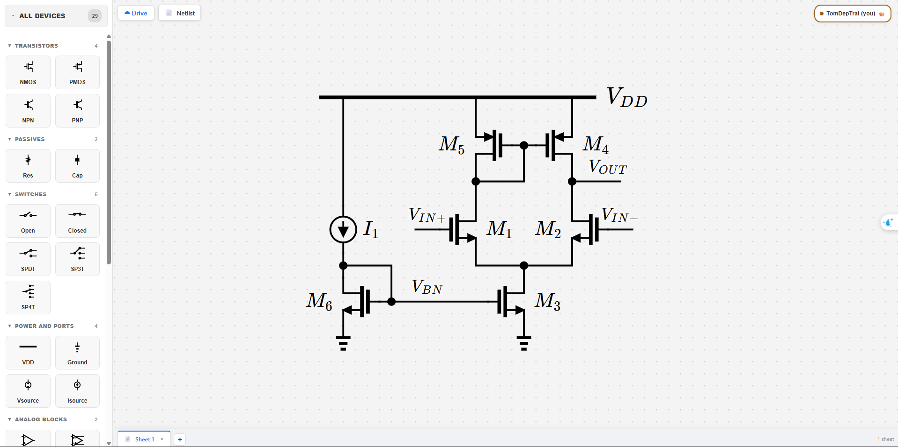
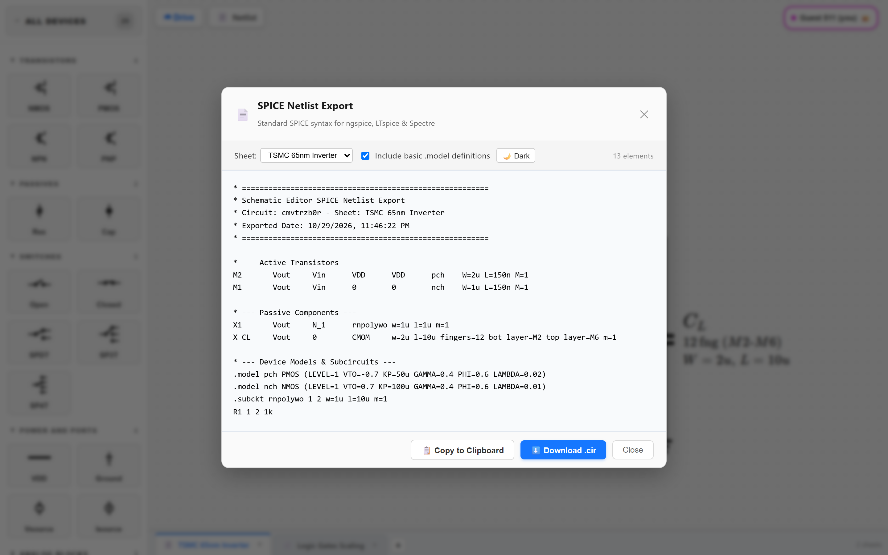

# Cadence Virtuoso Schematic Editor Clone

[](https://react.dev/)
[](https://vitejs.dev/)
[](https://DuyNguyen25092004.github.io/Schematic_Editor/)

A modern, high-performance web-based clone of the industry-standard **Cadence Virtuoso Schematic Capture** tool. Designed for analog, digital, and mixed-signal integrated circuit (IC) schematic design, orthogonal wiring, and direct SPICE/Spectre netlist export.

🚀 **Live Interactive Demo**: [https://DuyNguyen25092004.github.io/Schematic_Editor/](https://DuyNguyen25092004.github.io/Schematic_Editor/)

<p align="center">
  
</p>

---

## 🌟 Key Features

### 1. Component Library (Razavi Textbook Style)
All schematic symbols and drawing conventions follow the iconic textbook style of **Prof. Behzad Razavi** (*Design of Analog CMOS Integrated Circuits*), combining clean academic presentation with industrial Cadence Virtuoso parameters:

- **Active Transistors**: NMOS & PMOS (symmetrical 4-terminal symbols with Razavi-style source arrow), NPN & PNP bipolar transistors.
- **Physical Passives**: Resistors (Ideal Value & Physical $W/L$ Dimension modes) and Capacitors (Ideal, MIM, and multi-layer MOM with finger configuration).
- **Power & Ground**: Expandable horizontal $V_{DD}$ bus rail and standard Ground reference nodes.
- **Waveform Sources**: Independent Voltage (`VSOURCE`) and Current (`ISOURCE`) sources supporting DC, PULSE, SIN, and PWL waveforms.
- **Analog & Digital Blocks**: Single-ended Op-Amp, Fully Differential Op-Amp (FD-Opamp), Inverter, Buffer, D-Flip-Flop, 2:1 MUX, and Multi-Input Logic Gates (AND, OR, NAND, NOR, XOR, XNOR scalable from 2 to 16 inputs).
- **Switches & Annotations**: Switches (NO, NC, SPDT, SP3T, SP4T), functional subcircuit bounding boxes, and LaTeX mathematical annotations.

### 2. Virtuoso-Standard Orthogonal Wiring
- **Intelligent Orthogonal Router**: Single-click `W` key to activate Cadence-style orthogonal wire routing.
- **Distance Arbitration with Mid-Wire Priority**: Prevents unintentional jumping to nearby device pins when tapping directly into mid-wire segments.
- **Topological Junction Dot Computation**: Automatically places connection dots only on electrical junctions with degree $\ge 3$ (T-junctions, cross-connections). Clean corners ($90^\circ$ bends) and crossovers display no dots.
- **Automatic Inline Wire Merging & Segment Dragging**: Seamlessly drag wire runs with baseline anchor stability and automatic collinear segment simplification.
- **LaTeX Mathematical Net Labels**: Assign net names using mathematical LaTeX formatting (e.g., `$V_{DD}$`, `$V_{out}$`, `$\overline{Q}$`, `$A_{1}$`). SPICE exporter automatically sanitizes these into clean SPICE identifiers (`VDD`, `Vout`, `Q_b`, `A1`).

### 3. Production-Ready SPICE & Spectre Netlist Export
- **One-Click Netlist Generation**: Generates clean, simulation-ready netlists with standard node ordering.
- **Automatic Subcircuit (`X`) Prefixing**:
  - Conforms to TSMC 65nm / 28nm and Cadence Spectre requirements: any passive component or subcircuit block with a technology model (`rnpolywo`, `CMIM`, `CMOM`, standard cells) is automatically exported with prefix `X` (e.g., `X1 VOUT N_1 rnpolywo w=1u l=1u m=1`), preventing Spectre `ERROR (SFE-1997)`.
  - Primitive ideal passives retain standard `R` and `C` designations (`R1 VOUT 0 10k M=1`).
- **Accurate Transistor Pin Order**:
  - PMOS: `Drain Gate Source Bulk` (`M2 VOUT N_1 VDD VDD pch W=1u L=150n M=1`).
  - NMOS: `Drain Gate Source Bulk` (`M1 VOUT N_1 0 0 nch W=1u L=150n M=1`).
- **Autonomous Simulation Fallbacks**: Generates built-in `.subckt` and `.model` definitions when `Include Default Simulation Models` is checked.

<p align="center">
  
</p>

### 4. Real-Time Collaboration & Cloud Workspace
- **Multi-User Live Collaboration**: Real-time cursor presence and circuit synchronization powered by Firebase Realtime Database.
- **Google Drive Storage Integration**: Open, save, and auto-backup schematic capture sheets directly to Google Drive.
- **High-Resolution Snapshot Copy**: Instantly copy crisp, vector-like PNG snapshots of selected components or entire circuits to the clipboard via `Ctrl + Shift + C`.

---

## ⌨️ Cadence Virtuoso Keybindings

| Shortcut | Action | Description |
| :--- | :--- | :--- |
| `W` | **Wire Tool** | Toggle orthogonal wiring mode |
| `I` | **Instance / Add** | Open Quick Add component palette menu |
| `Q` | **Edit Properties** | Inspect and edit parameters of the selected component |
| `R` | **Rotate** | Rotate selected component by $90^\circ$ clockwise |
| `F` | **Flip / Mirror** | Horizontally mirror the selected component |
| `Delete` / `Backspace` | **Delete** | Delete selected component(s) or wire segment |
| `Ctrl + C` / `Ctrl + V` | **Copy / Paste** | Duplicate components on canvas |
| `Ctrl + Z` / `Ctrl + Y` | **Undo / Redo** | History undo and redo |
| `Ctrl + Shift + C` | **Copy Schematic Image** | Copy high-res circuit screenshot to system clipboard |
| `Double Click` | **Inspect** | Double-click any device or wire to edit properties or labels |
| `Escape` | **Cancel / Deselect** | Exit wire tool or clear current canvas selection |

---

## 🚀 Getting Started & How to Use

### 1. Placing Components
1. Press `I` or select a device from the left sidebar palette (**TRANSISTORS**, **PASSIVES**, **POWER AND PORTS**, **LOGIC GATES**, etc.).
2. Move your cursor to the desired grid location on the canvas and click to drop the component.
3. While placing or with a component selected, press `R` to rotate or `F` to flip.

### 2. Wiring Connections
1. Press `W` to enter **Wire Mode** (crosshair cursor appears).
2. Click any device terminal pin or existing wire.
3. Move the cursor: the orthogonal routing engine draws clean right-angle paths along the $10\text{px}$ grid.
4. Click another terminal or wire to complete the connection. Topological junction dots will appear automatically where 3 or more branches connect.
5. Press `Escape` or `W` to exit wiring mode.

### 3. Editing Component Parameters & Physical Dimensions
1. Select any component and press `Q` (or double-click it) to open the **Property Panel**.
2. **For Transistors**: Adjust Width ($W$), Length ($L$), Model Name (`nch`, `pch`, `nmos`, `pmos`), and Multiplier ($M$).
3. **For Resistors**: Toggle between **Value Mode** (e.g. `10k`) or **Dimension Mode** (e.g. $W=1\mu m, L=10\mu m, \text{Model}=\text{rnpolywo}$).
4. **For Capacitors**: Select **Value**, **MIM** ($W, L$), or **MOM** ($W, L, \text{Fingers}, \text{Layers}$).
5. **For Logic Gates**: Use the input stepper or preset buttons (`[2]`, `[3]`, `[4]`, `[8]`) to dynamically scale the gate pins between 2 and 16 inputs.

### 4. Labeling Nets & Wires
1. Double-click any wire segment to open the **Net Label Dialog**.
2. Enter standard text or LaTeX notation (e.g. `V_{DD}`, `V_{out}`, `CLK_{IN}`, `\overline{Q}`).
3. The schematic displays beautifully rendered LaTeX typography on canvas, and the SPICE netlist exporter automatically converts them into valid SPICE net names.

### 5. Exporting SPICE Netlist
1. Click **Export Netlist** in the top navigation bar.
2. Review the generated SPICE/Spectre netlist in the popup modal.
3. Click **Copy to Clipboard** or **Download .sp / .cir** to simulate directly in Cadence Spectre, NGSPICE, or LTspice.

---

## 🛠️ Project Structure

```
Schematic_Editor/
├── src/
│   ├── App.jsx                # Main application wrapper
│   ├── Flow.jsx               # Primary schematic canvas & interaction controller
│   ├── constants.js           # Pin coordinates, bounding boxes, component definitions
│   ├── index.css              # Global styling & layout
│   │
│   ├── components/            # UI Panels & Modals
│   │   ├── ComponentPalette.jsx   # Left device sidebar
│   │   ├── QuickAddMenu.jsx       # 'I' hotkey popup palette
│   │   ├── PropertyPanel.jsx      # 'Q' component inspector panel
│   │   ├── SpiceNetlistDialog.jsx # Netlist preview and export modal
│   │   ├── LatexText.jsx          # KaTeX typography renderer
│   │   ├── WiringLayer.jsx        # SVG wiring rendering
│   │   └── WireHandles.jsx        # Interactive wire drag handles
│   │
│   ├── netlist/               # SPICE & Spectre Generation
│   │   └── spiceExporter.js   # Disjoint-Set net resolution & SPICE/Spectre synthesis
│   │
│   ├── routing/               # Orthogonal Pathfinding
│   │   ├── router.js          # A* grid-based orthogonal router
│   │   └── resolveWire.js     # Path normalization & endpoint solver
│   │
│   ├── geometry/              # Math & Grid Utilities
│   │   ├── grid.js            # Grid snapping & unit conversions
│   │   ├── ports.js           # Port direction vectors & rotation transforms
│   │   └── pathUtils.js       # Segment geometry calculations
│   │
│   ├── wires/                 # Wire Topology & Intersections
│   │   ├── snap.js            # Mid-wire vs. terminal snap arbitration
│   │   └── wireOps.js         # Topological junction dot calculation & wire merging
│   │
│   ├── symbols/               # SVG Schematic Symbols
│   │   └── index.jsx          # Vector Cadence Virtuoso symbol renderers
│   │
│   ├── nodes/                 # ReactFlow Custom Node Implementations
│   │   ├── NmosNode.jsx       # NMOS custom node wrapper
│   │   ├── PmosNode.jsx       # PMOS custom node wrapper (symmetric pinout)
│   │   ├── NpnNode.jsx        # BJT NPN node wrapper
│   │   ├── TwoTerminalNode.jsx# Passives, sources & switches
│   │   └── SymbolNode.jsx     # Logic gates, opamps & multi-terminal devices
│   │
│   ├── cloud/                 # Cloud Storage
│   │   ├── CloudPanel.jsx     # Google Drive file browser panel
│   │   └── driveStorage.js    # Google Drive API synchronization
│   │
│   └── realtime/              # Multi-user Collaboration
│       ├── firebase.js        # Firebase app configuration
│       ├── useCircuitSync.js  # Realtime Database state synchronization
│       └── usePresence.js     # Live cursor and active user tracking
│
├── package.json               # Dependencies and build scripts
└── vite.config.js             # Vite build configuration
```

---

## 💻 Local Development Setup

Ensure you have [Node.js](https://nodejs.org/) (v18+ recommended) installed.

```bash
# 1. Clone the repository
git clone https://github.com/DuyNguyen25092004/Schematic_Editor.git
cd Schematic_Editor

# 2. Install dependencies
npm install

# 3. Start local development server
npm run dev
```

Open your browser and navigate to `http://localhost:5173/Schematic_Editor/`.

### Building for Production
```bash
# Compile and bundle with Vite
npm run build
```

### Deploying to GitHub Pages
```bash
# Build and push to gh-pages branch
npm run deploy
```

---

## 📄 License
This project is open-source and available under the [MIT License](LICENSE).
